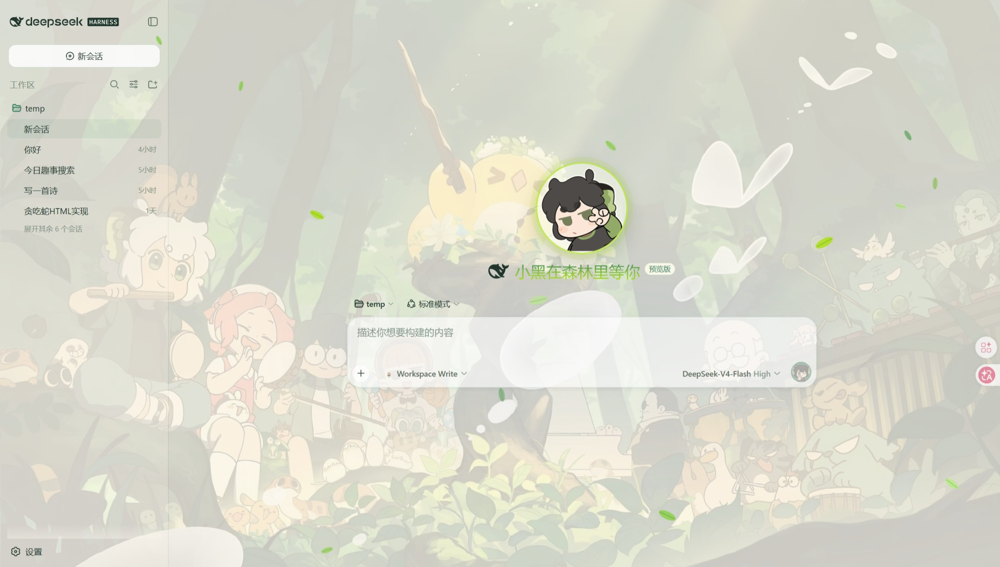
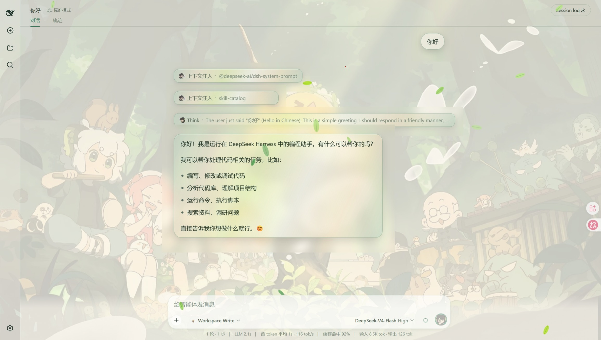
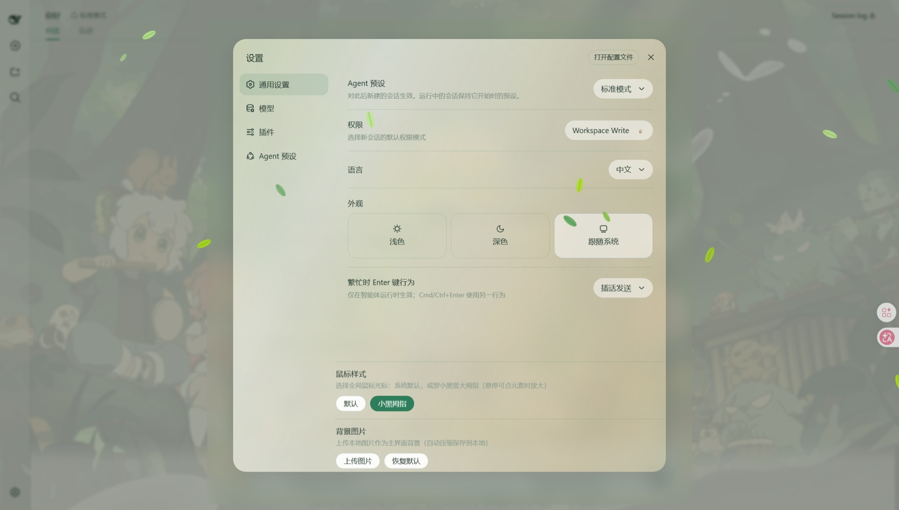

# 小黑森林 · DeepSeek Harness 主题

给 DeepSeek Harness 换上罗小黑主题。浅色「奶油森林」与深色「深夜森林」双主题，跟随系统深浅自动切换，让工作界面焕然一新。

> **兼容性**：已适配 **DeepSeek Harness 桌面端 App**（`desktop` profile）与命令行 `dsh web`（`web` profile），实测版本 `0.2.2-rc.1`。

## 效果

### 主界面



### 对话界面



### 设置面板



## 功能

- 浅色「奶油森林」/ 深色「深夜森林」双主题，跟随系统自动切换（也可在设置页强制指定）
- 森林插画背景 + 飘落叶片动效
- 透明玻璃气泡：AI 回答与工具调用都有干净的玻璃框
- 设置面板「变色玻璃」：多彩渐变缓慢流动 + 毛玻璃模糊
- 工具调用图标：思考 / 读取 / 写入 / 编辑 / 搜索 / 上下文注入各配小黑动图，其余工具（运行命令等）统一用兜底小黑图标
- **独立的「小黑森林」设置页**：主题模式、背景、落叶密度、发送键 / 图标 / 首屏装饰开关、鼠标样式、恢复默认，全部即时生效
- 自定义背景：上传本地图片，压缩后只存本机
- 停用皮肤即完全还原，不影响其他功能

## 安装

### 桌面端 App

桌面端的 profile（`desktop`）由 Electron 应用独占管理，`dsh plugin --profile desktop …` 会被拒绝（`profile "desktop" is managed exclusively by the Electron application`），请走应用内安装：

1. 打开桌面端 → 左下角「设置」→「插件」
2. 从本地路径或 Git 仓库安装 `dsh-skin-luoxiaohei`
3. 装好后重启桌面端应用（皮肤是客户端插件，重启或刷新页面后生效）

也可以手动挂载：把仓库 link 进 `~/.dsh/profiles/desktop/node_modules`，并在该 profile 的 `package.json` 里把 `dsh-skin-luoxiaohei` 追加到 `dsh.profile.bundles`。

### 命令行 / 浏览器（`dsh web`）

一键安装（交给 AI 助手或任意终端）：

```sh
dsh plugin --profile web add https://github.com/haohaozi328-arch/dsh-skin-luoxiaohei.git
```

手动安装：

```sh
git clone https://github.com/haohaozi328-arch/dsh-skin-luoxiaohei.git
cd dsh-skin-luoxiaohei
dsh plugin --profile web add .
```

安装后重启 `dsh web`，刷新页面即可生效。

## 卸载

```sh
dsh plugin --profile web remove dsh-skin-luoxiaohei
```

桌面端：设置 →「插件」里移除后重启应用（手动挂载的则从 `dsh.profile.bundles` 去掉并重装依赖）。

## 使用

打开「设置」→ 左侧导航里的 **小黑森林**，插件所有选项都收在这一页：

| 选项 | 说明 |
|---|---|
| 顶部开关 | 皮肤总开关。关掉后装饰与配色全部撤下，设置页仍然保留，方便随时开回来 |
| 主题模式 | 跟随系统 / 奶油森林（强制浅色）/ 深夜森林（强制深色） |
| 背景 | 森林插画 / 纯色玻璃 / 自定义（上传本地图片，最长边压到 1920、只存本机 localStorage） |
| 落叶 | 关 / 少 / 标准 / 多，四档密度 |
| 发送键皮肤 | 发送按钮上的小黑 GIF 覆盖层 |
| 工具与权限图标 | 工具调用行、权限菜单的图标替换 |
| 首屏形象与文案 | 欢迎页的小黑剪刀手与「小黑在森林里等你」标题 |
| 鼠标样式 | 系统默认 / 小黑拇指（输入框内保持文本光标） |
| 恢复默认 | 清空本机保存的所有皮肤设置 |

改动即时生效，不需要重启或刷新。设置保存在 `localStorage` 的 `dsh-skin-luoxiaohei:settings` 单键里，自定义背景图单独存 `dsh-skin-luoxiaohei:bg`。

## 更新记录

### 2026-11-06 · 0.2.1 · 对齐 DSH 0.2.2

DSH 0.2.2-rc.1 重写了首屏结构，皮肤的 Hero 装饰随之失效（静默不生效，不报错）：

- **首屏标题锚点**：`span[class*="headlineText"]` → `span[class*="titleGroup"] > span:first-child`（0.2.2 里标题是 `titleGroup` 下的纯文本 span，旁边是 `previewBadge`）。旧锚点保留为回退，老版本 DSH 仍然生效
- **首屏小黑插入点**：改为插到 `div[class*="_headline"]` 之前（容器 `div[class*="_stack"]`），跟着新结构走
- 复核了其余装饰锚点：AI 正文玻璃框（`_markdown_`）、用户气泡（`_bubble_` + `_userStack`）、工具行图标（`_leading_` + `[data-disclosure-row]`）、权限菜单图标（`_itemIcon_`）、发送键（`aria-label`）在 0.2.2 全部仍然命中 —— 这些类名来自 `dsh-client-ui-primitives`（打进前端 bundle，形如 `_markdown_1wejo_28`），没有被这轮重构影响
- 在 0.2.2-rc.1 的独立实例上实测：首屏小黑注入 ✓、标题替换 8 字 ✓、关掉开关还原「探索未至之境」✓、设置页与全部开关 ✓、控制台零报错

### 2026-11-05 · 0.2.0 · 设置页重做

- **修掉串页 bug**：旧版把「鼠标样式」「背景图片」两行注入 `[role="dialog"]` 里的第一个对话框，导致每个弹窗（包括非设置类弹窗）都会长出这两行。现在删掉整段 DOM 注入，改为注册到 DSH 的设置槽位 `settings.section`，只在小黑森林自己的页面出现
- **独立设置页**：新增 7 个选项（主题模式、背景来源、落叶密度、发送键 / 图标 / 首屏三个装饰开关、鼠标样式）+ 总开关 + 恢复默认，全部即时生效
- **主题模式**：皮肤样式表里的深色规则原来只认 `[data-ds-dark-theme]`，现在按设置做选择器改写 —— 强制深色改写成插件自己的 `[data-lxh-dark]`，强制浅色则整段失效
- **修掉装饰拆不干净的时序问题**：输入框晚于挂载才渲染时，发送键覆盖层由 MutationObserver 后补，而清理器只在「首次就装饰成功」时才注册，导致关掉开关后覆盖层残留。现在清理器无条件注册，并给 observer 的 rAF 回调加了拆卸守卫
- **拆卸改为逆序**：监听器先停、装饰再撤，避免拆到一半又被回调挂回去
- **构建链**：`scripts/build.mjs` 从 `scripts/client.template.js` + `scripts/parts/*` 生成 `lib/client.js`，素材从 `assets/` 读（缺了就从上一次的产物里还原），不再依赖 python

### 2026-09-24 · 适配 DSH 桌面端 `0.1.7-rc.2`

- **token 层叠覆盖**：DSH 的主题样式（`design-platform.css` 等）改为在插件样式之后注入，与皮肤同为 `body` 选择器时后者胜，90+ 个 `--dsw-alias-*` 被静默覆盖 —— 表现为森林背景消失（`AppFrame` 用不透明 `#fff` 盖住）。token 块改锚 `html body[data-dsh-luoxiaohei]`，不依赖注入顺序
- **设置面板「变色玻璃」**：锚点不再绑定构建 hash（`[role="dialog"].bi44ca_panel` → `role="dialog"`），并抬特异度压过面板自带背景，渐变与流动动画恢复
- **AI 正文玻璃框**：`[class*="gshEtW_body"] > [class*="_markdown_"]` → `[class*="_markdown_"]:not(:where([data-disclosure-row] *))`
- **工具图标**：识别本地化标题（思考 / 读取 / 写入 / 编辑 / 读取图片 / 搜索文件内容…），无专属素材的工具（运行命令 / bash / pwsh / 以后新增的）统一用兜底小黑图标；不再跳过没有标题的汇总行，同时显式跳过展开箭头
- **设置项找回**：设置面板内容容器改按结构查找（`[class*="_options"]` / `[class*="_content"]`），「鼠标样式」「背景图片」两行恢复，并补上小黑图标
- **代码块对比度**：深墨绿底配浅墨绿代码文字，`--shiki-token-*` 换成深底可读色系（对比度 1.4:1 → 12.7:1）
